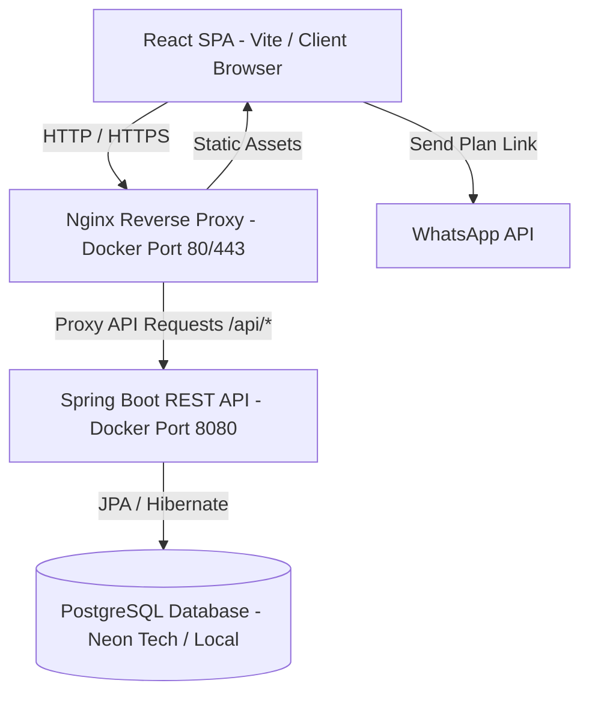
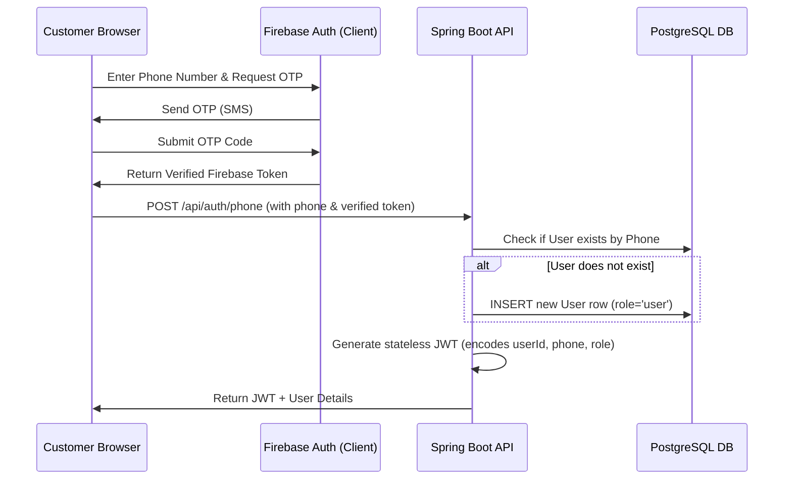

# My Morning: Technical Architecture & Security Documentation

This document provides a comprehensive overview of the **My Morning** meal delivery platform, detailing the frontend, backend, database models, user journeys, security controls, and deployment architecture.

---

## 1. Architectural Overview

The application is built using a modern decoupled architecture:
* **Frontend**: A React Single Page Application (SPA) built with Vite and styled using vanilla CSS.
* **Backend**: A Java Spring Boot REST API that handles business logic, security, and data storage.
* **Database**: A PostgreSQL relational database hosting operational tables and settings.



### Frontend-Backend Connection
The frontend communicates with the backend REST API via standard HTTP requests.
* **Axios/Fetch Helper**: A custom `authFetch` wrapper in `AuthContext.jsx` automatically attaches the JWT authentication token:
  ```http
  Authorization: Bearer <JWT_TOKEN>
  ```
  to the headers of all secure requests.
* **Request Redirection**: In production, the Nginx container proxies all requests originating on `/api/*` to the Spring Boot backend container (`http://backend:8080/api/*`), preventing CORS issues.

---

## 2. Core User Journeys & Flows

### A. Customer Onboarding & OTP Authentication


1. **OTP Verification**: Handled securely on the client side using Firebase Authentication. Firebase manages verification codes, preventing SMS brute-forcing and infrastructure overhead.
2. **Backend Registration**: Once Firebase verifies the OTP, the client sends the phone number to `/api/auth/phone`.
3. **Session Issuance**: The backend looks up the user or registers a new one, then generates a cryptographically signed JSON Web Token (JWT) containing the user's ID, phone number, and role, returning it to the client.

### B. Customer Subscription & Meal Planning
1. **Planner Interface**: Customers build their plan via `Subscription.jsx` (selecting 7, 14, 21, or 30 days and customizing their meal selections for each day).
2. **Database Save**: When clicking "Confirm & Send", the client calls `/api/subscriptions/save`. The backend:
   * Saves the subscription record in the `subscriptions` table.
   * Parses the customer's selected meals against the active menus in the admin settings.
   * Merges this data into the unified `excel_workbook` JSON in `system_settings` so it immediately shows up in the admin dashboard.
3. **WhatsApp Dispatch**: The client opens a WhatsApp chat pre-populated with their formatted meal plan, allowing them to notify the admin team.

### C. Admin Dashboard & 7-Sheet Excel Workbook
1. **Login**: Admins log in securely at `/login` with credentials checked against external properties.
2. **7-Sheet Workbook**: Admins manage operations via the **Excel Workbook** tab (`Admin.jsx`):
   * **Daily Orders (blue)**: Opens first. Auto-filters today's active deliveries. Pulls meals from Meal Preferences. Mark ✓ when dispatched to turn the row green.
   * **Customers (teal)**: Master register of customer names, phones, and addresses.
   * **Subscriptions (purple)**: Auto-calculates plan duration, pause days, effective end dates, and status.
   * **Pause Log (amber)**: Logs pause ranges per customer, extending the effective end date automatically.
   * **Delivery Schedule (blue)**: Toggles Mon-Sun delivery days. Calculates next delivery date.
   * **Meal Preferences (coral)**: Detailed daily breakfast, lunch, and dinner selections.
   * **Settings (gray)**: Configures the breakfast, lunch, and dinner menus.
3. **Persistence**: Saved as a single JSON blob under the `excel_workbook` key in `system_settings`, ensuring atomic updates and eliminating database schema migrations when new sheets/columns are added.

---

## 3. Security Engineering & Threat Mitigations

| Threat Vector | Mitigation Strategy | Implementation Details |
| :--- | :--- | :--- |
| **Credential Leakage** | Externalized configuration | Removed hardcoded admin email and password from Java code (`AuthController.java`). Injected them using `@Value` properties backed by environment variables (`ADMIN_EMAIL`, `ADMIN_PASSWORD`). |
| **Session Hijacking** | Stateless JWT Tokens | Authenticated requests require a cryptographically signed HMAC-SHA256 JWT token with a 24-hour expiration window. |
| **SQL Injection** | ORM Parametrization | Leveraged Spring Data JPA / Hibernate which automatically parameterizes all SQL queries. |
| **Unauthorized Endpoint Access** | Spring Security Filters | Enforced strict role-based access checks (`@PreAuthorize("hasRole('ADMIN')")`) for administrative endpoints. |
| **Data In-Transit Sniffing** | Enforced SSL/TLS | Implemented Let's Encrypt SSL. Forced Neon PostgreSQL connection strings to require SSL (`sslmode=require`). |
| **Cross-Origin Attacks (CORS)** | Restricted CORS Policy | Configured `SecurityConfig.java` to explicitly permit only trusted origins (e.g., local Vite ports and the production domain `mymorning.in`). |

---

## 4. Bi-Directional Synchronization Engine

To bridge the gap between the structured relational database and the flexible JSON-based admin workbook, a custom bi-directional sync engine runs on the backend:

```
[Customer Subscription Save]
             │
             ▼
[Subscription Table Update] ──► [Parse & Classify Meals] ──► [Update Settings JSON Blob]
                                                                        │
┌───────────────────────────────────────────────────────────────────────┘
│
▼
[Admin Edits Excel Workbook] ──► [Save Settings JSON] ──► [Update Subscription Table Rows]
```

### 1. User-to-Workbook Sync (Java `SubscriptionController`)
When a user updates their subscription on the frontend, the backend:
* Normalizes the customer ID as `CUST-<userId>` and subscription ID as `SUB-<userId>`.
* Adds/updates the customer profile in the workbook's **Customers** sheet.
* Matches the selected meals against the breakfast, lunch, and dinner option lists in the **Settings** sheet.
* Populates the **Meal Preferences** columns (`Mon_Breakfast`, `Mon_Lunch`, etc.) and the **Delivery Schedule** toggles (`Y`/`N`) accordingly.

### 2. Workbook-to-User Sync (Java `SettingsController`)
When the admin saves edits in the workbook, the backend:
* Iterates through the **Subscriptions** sheet.
* Looks up the corresponding customer's phone number and finds their `User` ID in the database.
* Collates their daily meal preferences (Breakfast + Lunch + Dinner columns) back into a single `mealsJson` map.
* Updates or inserts a record in the `subscriptions` table, ensuring the user immediately sees the changes in their client-side planner.

---

## 5. Deployment Architecture

The application is deployed on a Linux host VPS using **Docker Containers**:

### 1. Nginx Reverse Proxy (`frontend` Container)
* Binds to ports `80` (HTTP) and `443` (HTTPS).
* Redirects all port `80` traffic to HTTPS.
* Serves the compiled production React assets (`dist/`).
* Handles load balancing and reverse proxies `/api/*` requests to the Spring Boot container.
* Mounts `/etc/letsencrypt` from the host as read-only to load SSL certificates.

### 2. Spring Boot Web API (`backend` Container)
* Binds internally to port `8080`.
* Connects to a cloud-managed PostgreSQL database hosted on Neon Tech.
* Executes transactional business logic.

---

## 6. Future Recommendations

1. **Relational Database Migration**: If the user base grows past 5,000 active subscribers, migrate individual sheets of the workbook (like Pause Log and Delivery Schedule) into dedicated PostgreSQL database tables instead of a single JSON settings blob. This allows database-level indexing and faster queries.
2. **Rate Limiting**: Implement API rate-limiting using **Nginx limit_req** or **Bucket4j** on auth endpoints (`/api/auth/phone` and `/api/auth/login`) to prevent brute-force and Denial-of-Service (DoS) attacks.
3. **Database Audit Logging**: Set up Spring Data Envers to keep a detailed audit log of every change made to the `system_settings` table, ensuring you can revert the workbook state if an admin makes a mistake.
